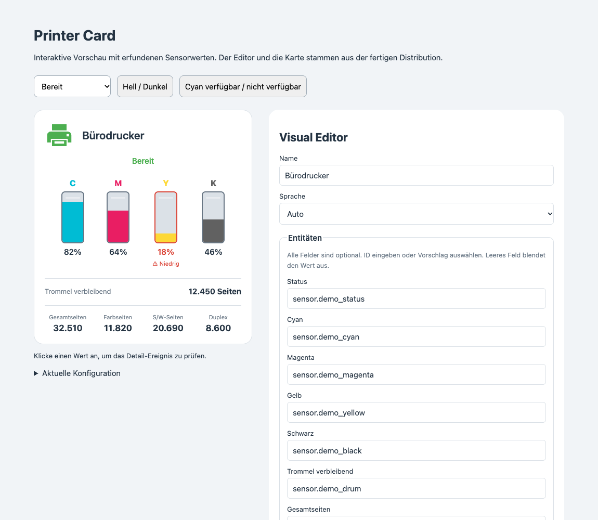

# Printer Card

Eine eigenständige **Home-Assistant-Lovelace-Karte** für Druckerstatus, vertikale **C/M/Y/K-Tonerstände**, optionale Wartungskomponenten und Seitenzähler – inklusive grafischem Konfigurationseditor.

[](LICENSE)
[](CHANGELOG.md)



Wenn dir **Printer Card** gefällt und du die weitere Entwicklung unterstützen möchtest:

<a href="https://buymeacoffee.com/soso1999">
  
</a>

## Funktionen

- **13 frei zuweisbare Entitäten:** Status, Cyan, Magenta, Gelb, Schwarz, Bandeinheit, Fixiereinheit, Trommel, Laser, Gesamtseiten, Farbseiten, S/W-Seiten und Duplex.
- Alle Zuordnungen sind optional; nicht konfigurierte Werte werden ausgeblendet. Auch reine Schwarzweißdrucker funktionieren.
- Grafischer Editor mit durchsuchbaren Vorschlägen aller vorhandenen Entitäts-IDs samt Anzeigenamen.
- Vertikale C/M/Y/K-Kartuschen mit einstellbarer Tonerwarnung.
- Optionale Restlebensdauer für **Bandeinheit, Fixiereinheit, Trommel und Laser**; Prozent- oder Restseitenwerte werden mit ihrer Einheit dargestellt.
- Statusfarben: bereit (grün), druckt (blau), Energiesparen (grau), kein Papier (rot), sonstiger Zustand (orange).
- Anpassbare Statusmuster einschließlich Fach 1/Fach 2; deutsche und englische Vorgaben.
- Optionaler pulsierender Drucker und Papierauswurf beim Drucken.
- Hell-/Dunkel-Themes, mobile Darstellung, Tastaturbedienung und `prefers-reduced-motion`.
- Klick auf Druckerkopf, Toner, Wartungskomponente oder Zähler öffnet den Home-Assistant-Detaildialog.
- Lokale Einzeldatei; keine externen Schriftarten, CDN-Imports oder Laufzeitpakete.

## Direkt installieren

Ein Build ist für die Nutzung **nicht erforderlich**. `dist/printer-card.js` und `printer-card.js` sind bereits enthalten.

1. `dist/printer-card.js` nach `<config>/www/printer-card.js` kopieren; `www` gegebenenfalls anlegen.
2. Im Dashboard unter **Ressourcen** die URL `/local/printer-card.js` als **JavaScript-Modul** hinzufügen.
3. Browser vollständig neu laden.
4. Dashboard bearbeiten → Karte hinzufügen → **Printer Card**.
5. Im Visual Editor die gewünschten Entitäten auswählen.

Falls die Karte noch nicht in der Kartenauswahl erscheint, eine manuelle Karte mit folgendem Inhalt anlegen und anschließend den visuellen Editor öffnen:

```yaml
type: custom:printer-card
```

Bei YAML-verwalteten Dashboard-Ressourcen:

```yaml
resources:
  - url: /local/printer-card.js
    type: module
```

Bei Updates Browsercache leeren oder die Ressourcen-URL um eine Versionsabfrage wie `?v=1.0.5` ergänzen. Jede Distribution nur einmal als Ressource laden.

## Installation über HACS

Das öffentliche Repository kann als **benutzerdefiniertes HACS-Dashboard-Repository** hinzugefügt werden:

1. HACS → Menü → **Benutzerdefinierte Repositories**.
2. `https://github.com/soso1999/printer-card` eintragen.
3. Kategorie **Dashboard** wählen.
4. **Printer Card** installieren bzw. aktualisieren.
5. Browser neu laden.

`hacs.json` verweist auf `printer-card.js`. GitHub-Releases enthalten die einzelne JavaScript-Datei. Eine Aufnahme in die HACS-Standardliste ist ein separater Prozess und für die Nutzung als benutzerdefiniertes Repository nicht erforderlich.

## Konfiguration

Alle Optionen sind über den Visual Editor zugänglich. Es werden keine Entitäten anhand eines Druckermodells automatisch vorausgewählt.

```yaml
type: custom:printer-card
name: Bürodrucker
language: auto
animation: true
toner_warning: true
warning_threshold: 20
entities:
  status: ""
  cyan: ""
  magenta: ""
  yellow: ""
  black: ""
  belt: ""
  fuser: ""
  drum: ""
  laser: ""
  total: ""
  color: ""
  bw: ""
  duplex: ""
```

| Option | Standard | Bedeutung |
| --- | --- | --- |
| `name` | leer | Titel; sonst Anzeigename der Statusentität oder „Drucker“ |
| `language` | `auto` | `auto`, `de` oder `en`; automatisch anhand der HA-Sprache |
| `entities` | `{}` | Frei gewählte Entitäts-IDs für die 13 optionalen Felder |
| `animation` | `true` | Druck- und Warnanimationen; Statusfarben bleiben aktiv |
| `toner_warning` | `true` | Warnrahmen und „Niedrig“ bei Toner unter/gleich der Grenze |
| `warning_threshold` | `20` | Prozentgrenze von 0 bis 100 |
| `status_patterns` | siehe unten | Musterlisten pro Kategorie |

### Toner

Tonerentitäten müssen den **verbleibenden Prozentwert** liefern. Zahlen und Prozentstrings wie `42`, `42%` oder `42,5` werden akzeptiert und auf 0–100 begrenzt.

`unknown`, `unavailable`, leere und ungültige Tonerwerte erscheinen als **—**, nicht als 0 %.

### Wartungskomponenten

`belt`, `fuser`, `drum` und `laser` sind optional. Die Karte zeigt den Sensorwert samt vorhandener Einheit an. Damit funktionieren beispielsweise Prozentwerte oder Restseiten.

Bei deutscher Anzeigesprache wird die Einheit `page`/`pages` als „Seiten“ dargestellt.

### Seitenzähler

`total`, `color`, `bw` und `duplex` werden als kompakte Zähler dargestellt. Vorhandene Einheiten werden dort bewusst nicht zusätzlich angezeigt, um redundante Angaben wie „32.510 Seiten“ in jedem Feld zu vermeiden.

Die Karte fragt selbst keinen Drucker ab. Für die Daten ist eine passende Home-Assistant-Drucker-, SNMP- oder Template-Integration erforderlich.

## Statusmuster

Standardkonfiguration:

```yaml
status_patterns:
  no_paper:
    - kein papier
    - no paper
    - no-paper
    - paper empty
    - out of paper
    - papier leer
  printing:
    - printing
    - ausdruck
    - '=druckt'
  powersave:
    - powersave
    - power save
    - energiesparen
    - sleep
    - ruhezustand
  ready:
    - '=ready'
    - '=bereit'
    - '=idle'
  tray1:
    - '*z1*'
    - '*fach 1*'
    - '*tray 1*'
    - '*tray1*'
  tray2:
    - '*z2*'
    - '*fach 2*'
    - '*tray 2*'
    - '*tray2*'
```

- Groß-/Kleinschreibung und äußere Leerzeichen werden ignoriert.
- Ohne Sonderzeichen: Teilstring.
- Präfix `=`: exakte Übereinstimmung.
- `*` steht für beliebig viele Zeichen, `?` für genau ein Zeichen.
- Keine regulären Ausdrücke. Pro Muster maximal 200 Zeichen.
- Eine eigene Liste **ersetzt** die Vorgaben dieser Kategorie.
- `[]` deaktiviert eine Kategorie.
- Priorität: fehlender/unverfügbarer Status → kein Papier → druckt → Energiesparen → bereit → sonstiger Rohtext.
- Fachmuster werden nur bei erkanntem Papierfehler ausgewertet.

## Entwickeln und testen

Node.js **22 oder neuer**.

```sh
npm run check
```

Das führt die Logiktests aus, baut `dist/printer-card.js` und prüft dessen Syntax.

### Interaktive Demo

```sh
python3 -m http.server 8000 --bind 127.0.0.1
```

Dann `http://127.0.0.1:8000/demo/` öffnen.

### Optionaler Browsertest

Benötigt lokal installiertes Google Chrome und Playwright:

```sh
npm install --no-save --package-lock=false playwright
node scripts/browser-test.mjs
```

Der Test prüft die gebaute Karte, alle 13 Editorfelder, vier Wartungskomponenten, Änderungen im Visual Editor, fehlende Werte, HTML-Escaping, Klickereignisse, mobile Darstellung, dunkles Theme und reduzierte Bewegung.

Siehe [VALIDATION.md](VALIDATION.md) für den dokumentierten Prüfstand.

## Release-Prozess

1. Version in `package.json` aktualisieren.
2. `npm run check` ausführen.
3. Sicherstellen, dass `dist/printer-card.js` und `printer-card.js` identisch sind.
4. Änderungen committen und pushen.
5. Einen Tag im Format `v1.0.5` pushen.

Der Release-Workflow prüft, ob Tag und `package.json`-Version zusammenpassen, baut die Karte erneut und erstellt ein GitHub-Release mit `printer-card.js` als Asset.

## Dateien

```text
src/                     Kartenlogik, Darstellung, Editor
scripts/build.mjs        Abhängigkeitsfreier Build
scripts/browser-test.mjs Optionaler Test mit Playwright/Chrome
test/                    Logiktests mit node:test
dist/printer-card.js     Direkt installierbare Distribution
printer-card.js          HACS-/Release-Datei im Repository-Root
demo/                    Interaktive Demo und Vorschaubilder
.github/workflows/       Checks und Tag-basiertes Release
hacs.json                HACS-Metadaten
```

## Referenzen

Die Schnittstellen für `setConfig`, `hass`, `getConfigElement` und `config-changed` orientieren sich an der Home-Assistant-Dokumentation für Custom Cards. Die Repository-Struktur folgt den HACS-Anforderungen für Dashboard-Plugins.

## Lizenz

MIT, siehe [LICENSE](LICENSE).
